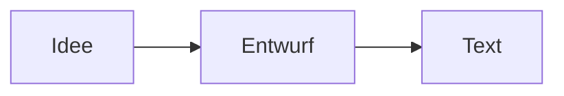

# Markdown-Referenz

Jeder Abschnitt zeigt zuerst die Schreibweise und darunter, wie Velotype sie darstellt. Mit **Strg+/** siehst du den Quelltext dieser Seite.

[TOC]

## Überschriften

```markdown
# Überschrift 1
## Überschrift 2
### Überschrift 3
```

Bis zu sechs Ebenen (`######`). **Strg+1** bis **Strg+6** setzen die Ebene, **Alt+Shift+↑/↓** ändern sie.

## Hervorhebungen

```markdown
**fett**, *kursiv*, ***fett und kursiv***, <u>unterstrichen</u>,
~~durchgestrichen~~, ==markiert==, H~2~O, x^2^
```

**fett**, *kursiv*, ***fett und kursiv***, <u>unterstrichen</u>, ~~durchgestrichen~~, ==markiert==, H~2~O, x^2^

Unterstriche mitten im Wort wie in `snake_case` bleiben normaler Text.

## Code

```markdown
Inline: `let x = 1;`
```

Inline: `let x = 1;`

````markdown
```rust
fn main() {
    println!("Hallo");
}
```
````

```rust
fn main() {
    println!("Hallo");
}
```

Die Sprache nach den drei Backticks steuert die Syntaxhervorhebung.

## Links

```markdown
[Pandoc](https://pandoc.org), <https://example.com>,
[Referenz-Link][doku], [[Andere Notiz]]

[doku]: https://pandoc.org/MANUAL.html
```

[Pandoc](https://pandoc.org), <https://example.com>, [Referenz-Link][doku]

[doku]: https://pandoc.org/MANUAL.html

Links öffnest du mit **Strg+Klick**. `[[Andere Notiz]]` verweist auf `Andere Notiz.md` im selben Ordner.

## Bilder

```markdown


```

Relative Pfade gelten ab dem Ordner des Dokuments. Mit `typora-root-url` in der Front Matter gelten Pfade, die mit `/` beginnen, ab einem eigenen Stammordner.

## Listen

```markdown
- Punkt
  - Unterpunkt
1. Erstens
2. Zweitens
- [ ] offen
- [x] erledigt
```

- Punkt
  - Unterpunkt

1. Erstens
2. Zweitens

- [ ] offen
- [x] erledigt

## Zitate und Hinweisblöcke

```markdown
> Ein Zitat.

> [!NOTE]
> Ein Hinweis. Auch TIP, IMPORTANT, WARNING und CAUTION.
```

> Ein Zitat.

> [!NOTE]
> Ein Hinweis. Auch TIP, IMPORTANT, WARNING und CAUTION.

## Tabellen

```markdown
| Links | Mitte | Rechts |
|:------|:-----:|-------:|
| a     |   b   |      c |
```

| Links | Mitte | Rechts |
|:------|:-----:|-------:|
| a     |   b   |      c |

Zeilen und Spalten fügst du per Rechtsklick ein; eine neue Tabelle legt **Absatz → Tabelle** oder **Rechtsklick → Einfügen → Tabelle** an.

## Mathematik

```markdown
Inline: $E = mc^2$

$$
\int_0^1 x^2 \, dx = \frac{1}{3}
$$
```

Inline: $E = mc^2$

$$
\int_0^1 x^2 \, dx = \frac{1}{3}
$$

## Diagramme

````markdown

````


## Fußnoten

```markdown
Ein Satz mit Fußnote.[^1]

[^1]: Der Text der Fußnote.
```

Ein Satz mit Fußnote.[^1]

[^1]: Der Text der Fußnote.

## Weiteres

```markdown
---
title: Metadaten (YAML Front Matter, nur am Dokumentanfang)
---

[TOC]                       ← Inhaltsverzeichnis
***                         ← Trennlinie
<!-- Kommentar -->           ← wird nicht angezeigt
\*kein kursiv\*             ← Backslash hebt Formatierung auf
```

---

\*kein kursiv\*
